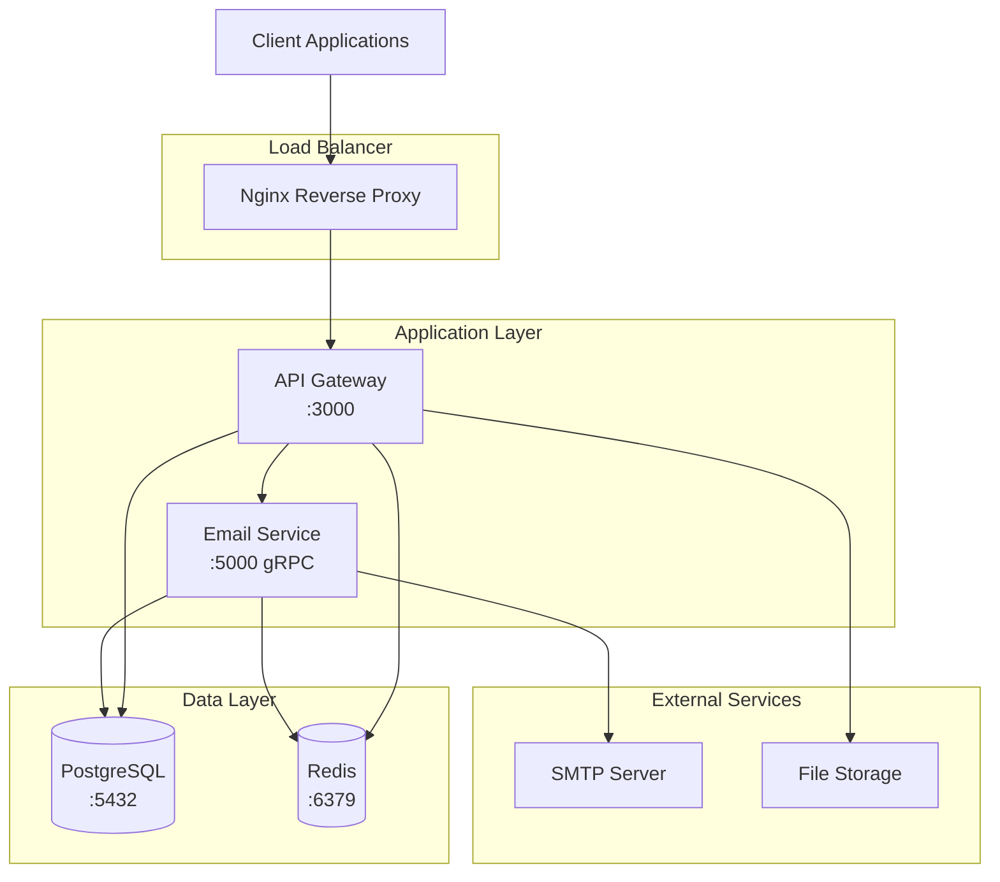

# HMT System Architecture

## Overview

HMT (Health Management Technology) is a microservices-based system designed for scalable email processing and API management.

## System Components

### 1. API Gateway (`hmt-apigateway`)
- **Technology**: NestJS, Express
- **Port**: 3000 (HTTP)
- **Purpose**: Central entry point, authentication, routing
- **Features**:
  - JWT Authentication
  - Rate limiting
  - Request validation
  - API documentation (Swagger)
  - File upload handling

### 2. Email Service (`hmt-email-service`)
- **Technology**: NestJS, gRPC
- **Port**: 5000 (gRPC)
- **Purpose**: Email processing and queue management
- **Features**:
  - Template-based emails
  - Bulk email sending
  - Queue management with Redis
  - Email tracking and analytics

### 3. PostgreSQL Database
- **Version**: 15
- **Port**: 5432
- **Purpose**: Primary data storage
- **Features**:
  - ACID compliance
  - JSON support
  - Full-text search
  - Connection pooling

### 4. Redis Cache/Queue
- **Version**: 7
- **Port**: 6379
- **Purpose**: Caching and job queuing
- **Features**:
  - Session storage
  - Email queue management
  - Rate limiting counters
  - Real-time data caching

### 5. Nginx (Production)
- **Port**: 80/443
- **Purpose**: Reverse proxy and load balancing
- **Features**:
  - SSL termination
  - Static file serving
  - Request routing
  - Security headers

## Architecture Diagram

## Communication Patterns

### 1. Client → API Gateway
- **Protocol**: HTTP/HTTPS (REST)
- **Authentication**: JWT Bearer tokens
- **Content**: JSON, multipart/form-data

### 2. API Gateway → Email Service
- **Protocol**: gRPC
- **Authentication**: Internal service communication
- **Content**: Protocol Buffers

### 3. Services → Database
- **Protocol**: PostgreSQL wire protocol
- **ORM**: Prisma
- **Features**: Connection pooling, migrations

### 4. Services → Redis
- **Protocol**: Redis protocol
- **Use Cases**: Caching, job queues, sessions

## Data Flow

### Email Processing Flow
1. Client sends email request to API Gateway
2. API Gateway validates and authenticates request
3. API Gateway calls Email Service via gRPC
4. Email Service queues job in Redis
5. Background worker processes email queue
6. Email sent via SMTP provider
7. Status updated in PostgreSQL

### File Upload Flow
1. Client uploads file to API Gateway
2. API Gateway validates file type/size
3. File stored in designated storage
4. Metadata saved to PostgreSQL
5. File reference returned to client

## Security Architecture

### 1. Network Security
- Private Docker network
- Service-to-service communication
- Firewall rules for external access

### 2. Application Security
- JWT token authentication
- Input validation and sanitization
- CORS policy enforcement
- Rate limiting per endpoint

### 3. Data Security
- Database encryption at rest
- TLS encryption in transit
- Environment variable secrets
- Regular security updates

### 4. Infrastructure Security
- Non-root container users
- Minimal container images
- Security scanning in CI/CD
- Regular backup procedures

## Scalability Considerations

### Horizontal Scaling
- Stateless application design
- Load balancing with Nginx
- Database connection pooling
- Redis cluster support

### Vertical Scaling
- Resource monitoring
- Container resource limits
- Database performance tuning
- Cache optimization

### Performance Optimization
- Database indexing
- Query optimization
- Caching strategies
- Background job processing

## Monitoring and Observability

### 1. Health Checks
- Application health endpoints
- Database connectivity checks
- Service dependency validation

### 2. Logging
- Structured JSON logging
- Centralized log aggregation
- Log rotation and retention

### 3. Metrics
- Application performance metrics
- System resource metrics
- Business logic metrics

### 4. Alerting
- Health check failures
- Performance degradation
- Error rate thresholds

## Deployment Architecture

### Development Environment
- Local Docker Compose
- Hot reload enabled
- Debug ports exposed
- Development database

### Staging Environment
- Production-like setup
- Automated deployments
- Integration testing
- Performance testing

### Production Environment
- High availability setup
- Load balancing
- SSL certificates
- Monitoring and alerting

## Technology Stack

### Backend
- **Runtime**: Node.js 18
- **Framework**: NestJS
- **Language**: TypeScript
- **ORM**: Prisma
- **Validation**: class-validator

### Database
- **Primary**: PostgreSQL 15
- **Cache**: Redis 7
- **Migration**: Prisma Migrate

### Infrastructure
- **Containerization**: Docker
- **Orchestration**: Docker Compose
- **Reverse Proxy**: Nginx
- **Process Manager**: dumb-init

### Development
- **Package Manager**: npm
- **Linting**: ESLint
- **Testing**: Jest
- **Code Formatting**: Prettier

### CI/CD
- **Platform**: GitHub Actions
- **Container Registry**: GitHub Container Registry
- **Security Scanning**: Trivy
- **Notifications**: Slack

## Best Practices

### 1. Development
- Follow TypeScript strict mode
- Use dependency injection
- Implement proper error handling
- Write comprehensive tests

### 2. Security
- Never commit secrets
- Use environment variables
- Implement proper validation
- Regular security updates

### 3. Operations
- Monitor application health
- Implement proper logging
- Regular backups
- Disaster recovery planning

### 4. Code Quality
- Code reviews for all changes
- Automated testing in CI/CD
- Static code analysis
- Documentation updates
